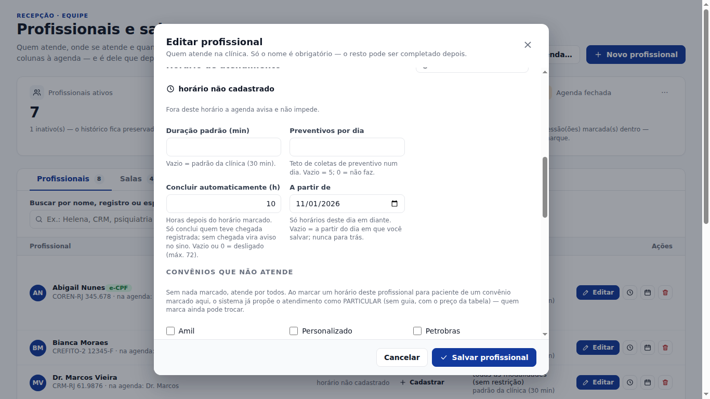

# Conclusão automática por profissional (nov/2026)

**O pedido (gerente, via dono).** Uma médica não usa o sistema. Ninguém conclui os atendimentos
dela, então as guias não nascem e o faturamento não dá baixa. Os atendimentos dela devem se concluir
sozinhos **10 horas depois do horário marcado** (consulta às 09:00 → concluída às 19:00).

**Decisão do dono.** Só conclui sozinho o horário que teve **chegada registrada** ("Chegou": na
recepção ou em atendimento). Horário sem chegada fica como está, para a recepção resolver (falta ou
esquecimento): não se cobra consulta que não aconteceu.

## Como funciona

- **Configuração por profissional, nunca o nome no código.** Cadastro do profissional (Recepção →
  Profissionais e salas → Editar) → **Concluir automaticamente (h)**: de 1 a 72; vazio ou 0 =
  desligado. Quem grava é quem edita o profissional (mesma tela, mesma permissão). A médica fica com
  10 quando a gerente gravar; nenhum valor vem pronto.
- **A partir de (data)** — pedido do dono: a gerente grava 10 h e **01/11/2026**. O relógio só olha
  horários com `DataHora` igual ou depois dessa data; **nada antes dela é tocado**, nem pelo aviso do
  sino. Data no passado é **retroativa** de propósito: gravar 01/11 em 18/11 conclui, na primeira volta,
  os horários de novembro com chegada que ficaram abertos. Sem data na tela, o serviço grava o **dia da
  gravação** (nunca para trás); salvar de novo não avança a data; desligar (0) apaga a data. Horas sem
  data (gravadas por fora do serviço) não concluem nada.
- **Teto de segurança retroativo: 120 dias.** A conclusão vai até a data "a partir de" (01/10 gravada em
  18/11 alcança 02/10), mas nunca além de 120 dias — a mesma janela da conferência de horários parados.
- **Teto por volta:** 50 conclusões por volta do relógio (uma volta por minuto), cada uma numa transação
  curta. Um mês retroativo de agenda cheia anda em poucos minutos sem prender o portal.
- **Conclui pelo mesmo serviço do "Concluir".** `AgendaService.ConcluirAtendimentoClinicoAsync`, o
  núcleo do botão: cria o atendimento e os códigos de faturamento (as guias pendentes de baixa),
  com particular e pacote como no clique, e grava a trilha `PresencaConfirmada`. A trava de consulta
  e a cobertura já foram conferidas quando o horário foi marcado; concluir não confere de novo (é a
  regra de todas as portas que concluem).
- **Quem assina:** o sistema, com a regra — `Conclusão automática (Dra. Ana, 10h)` — na trilha
  `ConclusaoAutomaticaPorProfissional`, com o horário, a hora da chegada e a hora em que concluiu.
  Nunca um usuário humano.
- **Idempotente.** Transação serializável e o mesmo bloqueio do horário que a conclusão por prazo já
  usa (`pg_advisory_xact_lock(20260916, id)`); a releitura dentro da transação vê o `Realizado` da
  primeira. Rodar duas vezes, ou na VPS e num app ao mesmo tempo, conclui uma vez e não duplica
  código (teste `Rodar_duas_vezes_conclui_uma_vez_so_e_nao_duplica_codigo`).
- **Sem prontuário.** Não cria evolução. A sessão ganha o carimbo `ConcluidoAutomaticamenteEm` e
  **não entra em "sessões sem evolução"** (Consultório da médica e alerta "prontuário em aberto" do
  painel da direção): foi o sistema que concluiu, não um esquecimento dela. ⚠️ O que isso significa
  para a clínica: a guia desta sessão sai **sem evolução escrita**; se a operadora auditar o
  prontuário, não há registro clínico. Isso é decisão da direção, não do sistema.
- **Sem chegada vira aviso.** Passado o prazo, o horário sem chegada aparece no **sino** da Recepção e
  do Gerente (quem edita a agenda), seção "Horários sem chegada": *"3 horários sem chegada na agenda
  de Dra. Ana: confirme falta ou presença."* O clique abre a agenda. Registrar a chegada ali faz a
  próxima volta do relógio concluir; registrar a falta tira o aviso. O sino cobra os últimos 30 dias, e nunca antes da data "a partir de". Os horários sem chegada mais velhos
  que isso (outubro, gravado em novembro) aparecem na **Agenda → Conferir atendimentos (horários
  parados)…** (`ConciliacaoAgendaService`, 120 dias, todos os profissionais), onde a recepção marca a falta,
  confirma a presença ou liga a uma sessão lançada por fora.
- **Cancelado, falta, substituído ou já concluído:** nada acontece.
- Remarcar ou estornar limpa o carimbo, como todo carimbo da fila.

## Onde roda — a comparação

O pedido trouxe três opções. Há uma quarta, que já existe e foi a escolhida: o **relógio da conclusão
automática** (`ConclusaoAutomaticaService.AcompanharAsync`), que desde set/2026 conclui sessões por
prazo e roda **na API do portal na VPS** (`Clinica.Assinaturas.Api`, serviço 24 h, `clinica-tablet`)
**e** nos apps da suíte abertos.

| | (a) conector TISS na VPS | (b) serviço novo na VPS | (c) só nos apps | **(d) o relógio da conclusão automática (feito)** |
|---|---|---|---|---|
| Roda com tudo desligado à noite | ✓ | ✓ | — | ✓ |
| Sem serviço, deploy ou systemd novo | ✓ | — | ✓ | ✓ |
| Sem permissão nova no banco | — | — | ✓ | ✓ (o portal já conclui sessões pelo mesmo núcleo) |
| Mesmo papel/assunto do hospedeiro | — (o conector só fala com operadora) | ✓ | ✓ | ✓ (já é quem conclui sessões) |
| Redundância se a VPS cair | — | — | — | ✓ (os apps abertos também rodam) |

- 🧑‍💻 **UX** — (d): às 19:00 a guia já está pendente de baixa, sem ninguém abrir nada; o sino só mostra
  o que pede ação. (c) concluiria às 08:00 do dia seguinte, quando a recepção abre o app.
- 🛠️ **DX** — (d): uma etapa a mais num laço que já tem transação, bloqueio, repetição e log; nenhum
  processo novo. (a) misturaria agenda num serviço cujo papel de banco foi desenhado mínimo (`Codigos`
  e `TransacoesTiss`); daria `UPDATE` em `Agendamentos`, `INSERT` em `Atendimentos` e mais, medido em
  `PapeisDoConectorTissTests` — o contrário do que aquele papel promete. (b) é um executável, um
  instalador, um usuário e uma unidade systemd para manter.
- 🤝 **CX** — (d): nada a instalar além do que já se publica (API do portal e apps); custo zero de
  máquina. (a)/(b) pedem mexer na VPS de produção.
- 🎨 **UI** — um campo no cadastro do profissional (sem tela nova) e uma seção no sino que já existe,
  com o mesmo desenho das outras.

## O que precisa ser publicado

- **Migration aditiva** `20261118202544_ConclusaoAutomaticaPorProfissional`: três colunas anuláveis
  (`Profissionais.ConcluirAutomaticamenteHoras`, `Profissionais.ConcluirAutomaticamenteDesde`,
  `Agendamentos.ConcluidoAutomaticamenteEm`). Os apps a
  aplicam na abertura.
- **API do portal na VPS** (`Clinica.Assinaturas.Api`) atualizada e ativa: é ela que conclui com todos
  os computadores desligados. O papel do banco do portal precisa ler a coluna nova de `Profissionais`
  e gravar a de `Agendamentos` — com `GRANT` por tabela, colunas novas já estão cobertas; com `GRANT`
  por coluna, falta acrescentar. **Não foi conferido no banco de produção.**
- **Recepção e Gerente** (o sino e o campo no cadastro). Os apps também rodam a conclusão enquanto
  abertos.
- **Conector TISS: nada.** VPS: nada além da API do portal.

## Evidências

Testes: `tests/Clinica.Tests/ConclusaoPorProfissionalTests.cs` (com chegada conclui às 19:00 e gera
os códigos; 30/10 com a data 01/11 não conclui nem avisa e 05/11 conclui na primeira volta; 01/11 09:00
conclui às 19:00; sem data nada para trás; sem chegada não conclui e avisa; cancelado e falta nada; duas vezes conclui uma; sem a
configuração nada; cadastro 0/nulo/fora da faixa; frases e operador) e a tradução para o Postgres em
`TraducaoNoNpgsqlTests`. Fotos do cadastro em `docs/evidencias/conclusao-automatica-por-profissional/`.

