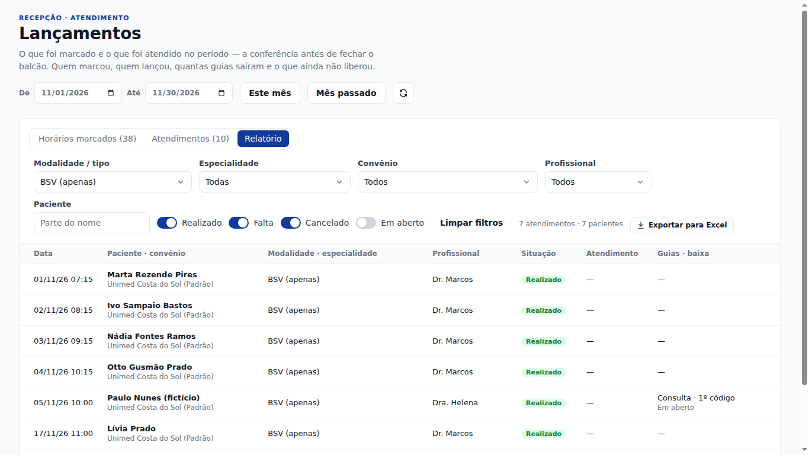

# Relatório de atendimentos com exportação para o Excel (nov/2026)

**O pedido (cliente, via dono).** "Se ela quiser saber quais pacientes são de BSV do mês e quais são os
convênios deles, a gente não tem essa possibilidade." Um relatório de atendimentos que se filtre como
planilha: por modalidade ou tipo, especialidade, convênio, profissional, situação e período, com todos os
resultados, e exportado para o Excel.

## Onde ficou — uma porta por pergunta

**Lançamentos → vista "Relatório"** (a terceira, ao lado de "Horários marcados" e "Atendimentos"). Não há
tela nova nem item novo no menu: Lançamentos já é a porta de "o que aconteceu no período", já tinha busca
por paciente e já exportava CSV dos atendimentos. Está na **Recepção**, no **Gerente** (que carrega o módulo
da Recepção) e no **/gestao** (`catalogo-gestao.json`, chave `lancamentos`).

| | **Lançamentos → Relatório (feito)** | Relatório por profissional (Repasses) | Relatórios de guias (Faturamento) | Fila 360 | Tela nova |
|---|---|---|---|---|---|
| Já responde "o que aconteceu no período" | ✓ | ✓ (só realizados) | — (guias, não horários) | — (carteira de pacientes) | — |
| Está na Recepção, no Gerente e no /gestao | ✓ | — (Financeiro) | — (Faturamento) | ✓ | — |
| Mostra falta e cancelado | ✓ | — | — | — | ✓ |
| Sem item novo de menu | ✓ | ✓ | ✓ | ✓ | — |
| Não mistura valores de repasse com lista de pacientes | ✓ | — | ✓ | ✓ | ✓ |

- 🧑‍💻 **UX** — quem já confere o balcão em Lançamentos acha o relatório no mesmo lugar, um clique ao lado.
  O período do relatório começa no mês corrente, com "Este mês" e "Mês passado"; cada filtro relê na hora.
  A lista diz "N atendimentos · M pacientes".
- 🛠️ **DX** — a regra mora na Application (`RelatorioDeAtendimentosRegras`, `RelatorioDeAtendimentosService`,
  `PlanilhaXlsx`), com teste; a consulta, no repositório (`ConsultaRelatorioDeAtendimentos`), na rede de
  tradução do Npgsql. A tela ganhou um arquivo parcial (`LancamentosDoBalcao.Relatorio.cs`).
- 🤝 **CX** — nenhuma migration, nenhum pacote novo, nenhum item de menu a ensinar.
- 🎨 **UI** — os componentes da casa (`Campo`, `Selo`, `EstadoVazio`, `FalhaDeLeitura`), a mesma barra de
  filtros das outras duas vistas, CSS só com token.

## O que a vista faz

- **Filtros**, todos no banco: período (pela data do horário), modalidade/tipo (catálogo real, inclusive
  as personalizadas), especialidade, convênio (os do catálogo, inclusive personalizados como SulAmérica, e
  "Particular"), profissional, situação (realizado, falta, cancelado e, se marcado, em aberto) e parte do
  nome do paciente. "Particular" é a marca do horário ou a ficha cujo convênio não gera guia — a mesma
  regra do fechamento; o paciente de convênio atendido como particular sai do filtro do convênio dele.
- **Totais**: atendimentos e pacientes distintos.
- **Linha**: data e hora, paciente, convênio e carteirinha, modalidade e especialidade, profissional,
  situação, nº do atendimento, guias e status da baixa.
- **Desempenho**: o banco devolve só o recorte, com as guias na mesma ida; teto de 366 dias por leitura.

## O arquivo

**.xlsx de verdade**, gerado sem biblioteca (`PlanilhaXlsx`, com `System.IO.Compression`, que já vem no .NET):

- uma aba "Atendimentos"; cabeçalho em negrito e **congelado**; **filtro automático ligado** em todas as
  colunas (`autoFilter` + o nome oculto `_xlnm._FilterDatabase` que o Excel usa);
- **data como data** (dd/mm/aaaa), **hora como hora** (hh:mm), **"Qtd. de guias" como número**; o resto texto;
- texto vai como `inlineStr`: o Excel não avalia, então um nome começando por "=" não vira fórmula;
- colunas: Data, Hora, Paciente, Convênio, Carteirinha, Modalidade / tipo, Especialidade, Profissional,
  Situação, Nº do atendimento, Guias / códigos, Qtd. de guias, Status da baixa.

| | **.xlsx sem biblioteca (feito)** | ClosedXML / Open XML SDK | CSV pt-BR com `;` |
|---|---|---|---|
| Filtro automático já ligado ao abrir | ✓ | ✓ | — |
| Data e número com tipo | ✓ | ✓ | — (o Excel adivinha pela região) |
| Sem pacote novo nos cinco apps | ✓ | — | ✓ |
| Fórmula neutralizada sem truque | ✓ | ✓ | — (`CsvParaExcel` prefixa) |

- 🧑‍💻 **UX** — abre no Excel já com as setinhas de filtro: "BSV do mês por convênio" é um clique.
- 🛠️ **DX** — ~200 linhas, um arquivo, testado abrindo o zip e lendo o XML.
- 🤝 **CX** — nada a baixar nem licença a acompanhar.

## LGPD e permissão

- Exportar uma lista de pacientes é **saída de dado pessoal**. Exige **`VerFichaPaciente`** — o mesmo bit
  da exportação da Fila 360 —, com as duas barreiras: o botão nasce desabilitado sem o bit e o clique chama
  `Exigir`; o serviço confere de novo e recusa (`UnauthorizedAccessException`).
- **Nada clínico**: a consulta não lê evolução, diagnóstico nem prontuário — só cadastro e faturamento.
- **Trilha**: cada exportação grava `RelatorioAtendimentosExportado` com o operador logado, o filtro inteiro e
  quantas linhas saíram, no mesmo `SaveChanges`. A trilha é gravada ao gerar o arquivo, antes de a pessoa
  escolher onde salvar (quem desiste da janela de salvar continua registrado como quem gerou).

## Publicar

Recepção e Gerente (a vista mora na Ui compartilhada) e a gestão web (/gestao). Sem migration, sem VPS além
da gestão, sem conector.

## Evidências

`tests/Clinica.Tests/RelatorioDeAtendimentosTests.cs` (BSV do mês com o convênio de cada um; filtros de
situação, convênio, particular, profissional, especialidade e paciente; período recusado; o .xlsx com o
filtro automático, o cabeçalho e os tipos; sem permissão não exporta nem grava trilha; fórmula não avaliada)
e `TraducaoNoNpgsqlTests.Relatorio_de_atendimentos_traduz_todos_os_filtros_no_banco`. Fotos em
`docs/evidencias/relatorio-de-atendimentos/`.

