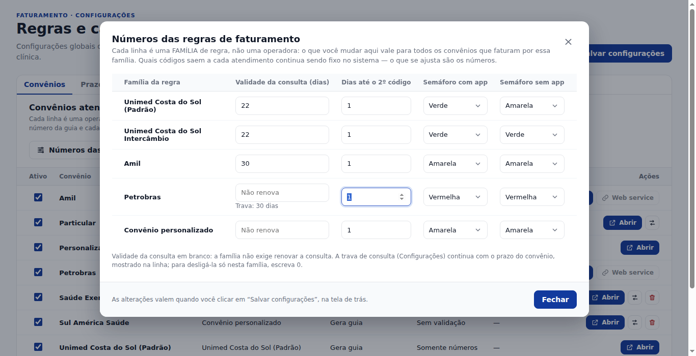

# Trava de consulta do convênio e liberação pela gerência

**Nov/2026.** Pedido da gerência, por áudio:

> "A Sul América realiza a consulta a cada 15 dias. Se a secretária tentar fazer um agendamento
> de uma consulta antes do prazo, vai ter uma box para pedir a liberação da gerência. Quando ela
> clicar, vai chegar uma mensagem no WhatsApp da gerência para liberar sim ou não — com o
> paciente, convênio, data, número do atendimento. Quando liberar, vai chegar a mensagem para o
> paciente e uma para a secretária informando que o atendimento foi agendado. As Unimed têm, a
> Amil, a Petrobras, a Sul América têm — a recepção precisa respeitar essas regras."

Decisões da direção sobre o desenho: **aprovação respondendo "sim/não" no WhatsApp**; o prazo é
o **já cadastrado** (validade da consulta de cada convênio); vale para **qualquer consulta**
(outra especialidade ou outro médico não zeram o prazo); **só consulta**; aprova quem tem o
perfil de **gerente e foi marcado em Acessos** (há mais de um gerente). No mesmo pedido: preço
por profissional, pré-marcar particular quando o profissional não atende o plano, e indicadores
do Gerente por convênio.

## O que existia

- O prazo por convênio já estava cadastrado (Unimed 22 dias, Amil e Petrobras 30, os
  personalizados no cadastro), mas servia só para avisar "consulta a renovar" — não impedia.
- A agenda "avisa e não impede" (decisão de set/2026). Esta trava **inverte isso para
  consultas**, por decisão nova — por isso ela nasce atrás de uma chave, desligada.
- O **WhatsApp da equipe** já existia: cada login com o celular cadastrado em Acessos, o CRM
  reconhece o número, encaminha a mensagem à ponte e a ponte responde **em nome daquele
  login**; e o CRM já entrega avisos a esses números. Foi o que tornou a opção A viável sem
  mexer no CRM.

## Onde a gerência aprova — as opções

| | 🧑‍💻 UX | 🛠️ DX | 🤝 CX |
|---|---|---|---|
| **A. Responder "sim/não" no WhatsApp** — **a escolhida pela direção** | O mais rápido para a gerência: decide do celular, sem abrir o sistema | Reusa o WhatsApp da equipe (número → login); nenhuma mudança no CRM | Quem decide é o login dono do número cadastrado em Acessos; fora da janela de 24 h da Meta a mensagem não chega (ver "Limites") |
| **B. Só dentro do sistema** | A gerência fora do computador não vê; a secretária espera | O mais simples | Trilha limpa, liberação lenta |
| **C. WhatsApp avisa, aprovação com login** | Um toque a mais (entrar) | Uma tela de aprovação a mais | Não depende de o número ser da pessoa |

Foi feita a **A, com a B por baixo**: o pedido chega ao WhatsApp **e** à conversa com o
sistema, no app — e a gerência decide por qualquer uma das duas, com as mesmas palavras. É a B
que mantém o fluxo de pé quando o WhatsApp não entrega.

## O que foi entregue

**1 · A trava.** Com a chave ligada (Gerente › Configurações › Operação › *Trava de consulta dos
convênios*), marcar uma **consulta pelo convênio** de um paciente que já tem outra dentro do
prazo é **recusado** — para trás e para a frente (já marcada adiante). Vale em todas as portas
(formulário do horário, Marcar/Lançar, lista de espera, série, CRM). Não é travado: consulta
**particular**, acupuntura/eletro/BSV, e **editar** uma consulta que já estava marcada (só
mudar o **dia** confere de novo). Concluir e confirmar presença nunca conferem — a trava é da
marcação.

**2 · A box.** Nas duas telas de marcar, antes do Salvar: *"Unimed aceita uma consulta a cada 22
dias, e a última deste paciente foi em 07/11 (atendimento 2026-000123). Nova consulta pelo
convênio a partir de 29/11."* Três saídas: outra data, **Marcar como particular**, ou **Pedir
liberação à gerência…** (motivo obrigatório). O Salvar apaga e diz por quê.

**3 · O pedido.** Vai a cada gerente marcado em Acessos — WhatsApp (se o celular do sistema
estiver cadastrado) e conversa com o sistema — com paciente, convênio, prazo, última consulta e
nº do atendimento, a consulta pedida, o motivo e quem pediu. No WhatsApp ele sai como **modelo
aprovado da Meta** (`liberacao_de_consulta`, com os botões **Liberar** e **Negar**), que é o
que chega fora da janela de 24 h; o texto do modelo e como cadastrá-lo estão em
`semdor-crm/docs/liberacao-de-consulta-modelo.md`. A tela diz **a quantos chegou e
por onde**. Sem ninguém marcado, o pedido é recusado dizendo onde marcar.

**4 · A decisão.** A gerência **toca no botão** do modelo — ou responde **sim** / **não**,
**liberar 12** / **negar 12 motivo**. Liberado: o horário é **marcado pela agenda de sempre**
(ou **remarcado**, se o pedido nasceu de uma remarcação) e a secretária recebe o desfecho na
conversa com o sistema (e no WhatsApp, se tiver). O **paciente recebe a mensagem de agendamento
que o CRM já manda** para todo horário novo — a liberação não tem mensagem própria. Negado ou sem resposta em 48 h (ou até a hora da consulta): nada é
marcado e a secretária é avisada. Tudo na trilha, com o nome de quem pediu e de quem decidiu.

**5 · Acessos.** No cadastro do usuário com perfil de gerente: *"Aprova liberação de trava de
consulta dos convênios"*. Sair do perfil de gerente tira a marca.

**6 · Preço por profissional.** A tabela do particular ganhou o **Profissional** (em branco =
todos). O preço de quem atende **ganha** do geral; o de outro profissional nunca serve. Vale no
formulário do horário, no Marcar/Lançar e no Finalizar.

**7 · Particular pré-marcado.** No cadastro do profissional: **Convênios que NÃO atende**. Ao
marcar com ele um paciente de um desses planos, o horário já vem como **Particular**, com a
nota *"Dra. X não atende pelo Y — veio marcado como particular"*. É sugestão: quem marca troca.

**8 · Indicadores por convênio.** Gerente › Indicadores ganhou **Atendidos por convênio**:
conta a **sessão** pelo pagador dela (a consulta particular de quem tem plano entra em
"Particular"), com pacientes e % do período.

### 🧑‍💻 UX
A secretária vê a trava **antes** de salvar, com a data em que solta e as saídas na mesma box —
sem trocar de tela. A gerência decide com uma palavra, do celular. O paciente recebe a
confirmação sem o bastidor (nada de "liberado"). Nenhum item de menu novo: a box mora nas telas
de marcar; a marca de quem aprova, em Acessos; a chave, em Configurações. Quando o WhatsApp
falha, o pedido está na conversa com o sistema e a resposta lá vale igual.

### 🛠️ DX
- A regra é pura: `Clinica.Domain/Regras/TravaDeConsulta`. Quem aplica é o
  `AgendaService.TravaDeConsultaAsync` — a MESMA resposta para a box e para a gravação.
- O pedido: `LiberacaoDeTravaService` (Infrastructure, banco direto, como os pedidos à
  recepção); as telas o alcançam por `ILiberacaoDeTravaService`. Frases e leitura do
  "sim/não": `LiberacaoDeTravaRegras` (Application, com teste).
- A decisão entra por `SistemaEquipeService` (chat do app) e `AssistenteWhatsAppService`
  (WhatsApp) — antes das outras perguntas. **Sem o número do pedido, só a palavra sozinha
  decide**: "não vou conseguir hoje" não nega nada.
- As mensagens à equipe saem na fila `staff/notices` que o CRM já lê, com o número
  **negativo** (−id). O contrato `StaffNotice` ganhou três campos no fim, com padrão
  (`Template`, `Parameters`, `ButtonPayloads`), e o CRM passou a enviar como modelo quando o
  aviso pede um e ele está aprovado na conta — senão, texto livre, como antes.
- Ao paciente nada sai daqui: o horário liberado é horário novo, e a "mensagem ao marcar" do
  CRM o confirma. O corpo do modelo mora em `LiberacaoDeTravaRegras.CorpoDoModelo`, com teste
  que casa os campos com `ParametrosParaGerencia`.
- A decisão é reivindicada com UPDATE condicional: dois gerentes ao mesmo tempo não marcam dois
  horários.
- Quem aprova é uma coluna do usuário, **não** um bit de `Permissao` — o enum está no último
  bit de um `int` em produção.
- Migration aditiva `TravaDeConsultaEPrecoPorProfissional` (duas tabelas, três colunas).
- Rede: `TravaDeConsultaTests` (29), `PrecoPorProfissionalEConveniosTests` (8) e a linha nova
  da `TraducaoNoNpgsqlTests`.

### 🤝 CX
- **Nada muda até a direção ligar a chave.** Ordem: (1) cadastrar o modelo
  `liberacao_de_consulta` na Meta e esperar a aprovação; (2) publicar o CRM e os apps;
  (3) rodar de novo `deploy/ponte-crm/papel-ponte-crm.sql` e reiniciar a ponte; (4) marcar em
  Acessos quem aprova e o celular de cada um; (5) ligar a chave.
- O faturamento (`Clinica.Desktop`) e o CRM passam a **recusar** a consulta dentro do prazo
  quando a chave liga, com a frase que diz o prazo — mas **não têm o botão de pedir
  liberação**; o pedido é feito pela Recepção.
- Risco coberto: quem não é gerente marcado não decide; "sim" sem pedido aberto é conversa
  normal; pedido repetido para o mesmo dia não vira dois.
- Publicar: Recepção, Gerente, Consultório e Financeiro (moldura e chat), e a ponte do CRM.

## Limites que a clínica precisa conhecer

1. **O modelo precisa estar aprovado na Meta.** Com ele, o pedido chega à gerência a qualquer
   hora. Sem ele (ou se alguém mudar o número de campos), o pedido sai como mensagem livre, que
   só chega a quem escreveu ao número da clínica nas últimas 24 h — e continua, sempre, na
   conversa com o sistema. O desfecho à secretária é mensagem livre (ela o lê no app).
2. **O que precisa estar ligado no CRM**: `CRM_STAFF_WHATSAPP_ENABLED` (pedido e resposta da
   gerência) e a **mensagem ao marcar**, em Automação (confirmação ao paciente — a de sempre:
   horário marcado há até 2 h e com mais de 1 h de antecedência; remarcação não repete).
3. **O horário não fica reservado** enquanto a gerência decide. Liberado, ele é marcado pela
   agenda; se a agenda recusar (agenda protegida, vaga de preventivo), a gerência e a
   secretária leem o motivo, e a liberação continua valendo para aquele paciente naquele dia.
4. **A identidade é o número cadastrado em Acessos.** Celular trocado ou emprestado responde em
   nome do dono do cadastro — o mesmo limite do WhatsApp da equipe que já existe.

## O que ficou de fora, com o motivo

- **Tela de pedidos pendentes** (lista com botões): o pedido e o desfecho vivem na conversa com
  o sistema. Se a gerência sentir falta de uma lista, é uma tela pequena sobre a mesma tabela.
- **Botão de pedir liberação no CRM e no faturamento**: lá a trava só recusa.
- **Preço por profissional na Conciliação**: a linha da sessão sem receita não conhece o
  profissional, então a Conciliação propõe o preço geral. O Finalizar propõe o do profissional.
- **Trava para acupuntura/eletro**: decisão da direção — só consulta.
- **Redes que não rodaram aqui**: a suíte contra o Postgres (há migration e consultas novas —
  vale rodar com `CLINICA_TESTES_POSTGRES` antes de publicar) e os testes do tablet. O fluxo
  ponta a ponta com o WhatsApp de verdade **não foi testado** — depende do modelo aprovado.

Evidências (prévia com dados fictícios): `docs/evidencias/trava-de-consulta/`.

---

## Correção de 10/11/2026: só a MESMA especialidade com o MESMO médico

**O que aconteceu.** No primeiro dia com a trava ligada, a clínica foi barrada ao marcar uma
consulta de Clínica da Dor de uma paciente que tinha consultado outra coisa três dias antes. A
direção: "funcionou, mas o bloqueio só pode ser se for a mesma especialidade e o mesmo médico
durante o período".

Isso REVOGA a decisão original deste documento ("vale para qualquer consulta, especialidade e
médico"). Agora:

- a trava só compara consultas pelo convênio da **mesma especialidade** com o **mesmo
  profissional**; outra especialidade, ou a mesma com outro médico, marca normalmente;
- a frase da recusa diz quais ("…aceita uma consulta de Endocrinologia com Dra. Patrícia a cada
  22 dias…");
- a box da tela só acende depois de escolhidos a especialidade e quem atende — antes disso não
  há o que comparar;
- remarcar trocando a especialidade ou o médico confere de novo;
- o pedido de liberação à gerência continua igual, para o caso que ainda trava.

| | A — mesma especialidade + mesmo médico (feito, pedido da direção) | B — qualquer consulta (a versão anterior) | C — só a mesma especialidade |
|---|---|---|---|
| 🧑‍💻 UX | trava só o retorno antecipado ao mesmo médico | barrou consultas legítimas no primeiro dia | barraria a segunda opinião com outro médico |
| 🛠️ DX | dois filtros na mesma leitura; a consulta ao banco ganhou duas colunas | — | um filtro |
| 🤝 CX | menos pedidos de liberação desnecessários à gerência | gerência acionada à toa | meio-termo que ninguém pediu |

- 🧑‍💻 **UX** — menos bloqueio indevido; a frase explica exatamente o que está sendo comparado.
- 🛠️ **DX** — `AgendaService.TravaDeConsultaAsync` ganhou `especialidadeCodigo` e `profissionalId`
  (sem um dos dois, devolve nulo); `ConsultaParaTrava` carrega os dois. Testes novos em
  `TravaDeConsultaTests`; a leitura continua em `TraducaoNoNpgsqlTests`.
- 🤝 **CX** — publicar Recepção e Gerente; a ponte do CRM, para valer na marcação pelo WhatsApp.

---

## Correção de 18/11/2026: todas as portas, prazo em branco e janela por convênio

**O que aconteceu.** Com a trava ligada e sem liberação nenhuma, um paciente da Saúde Petrobras
teve três consultas de Psiquiatria com o mesmo médico em 22 dias (20/10, 04/11 e um encaixe em
11/11); a operadora glosa consulta a menos de 30 dias da anterior. (Os números reais ficaram na
investigação; aqui e nos testes só há dados fictícios.)

**A causa não foi uma porta sem trava.** O horário nasceu pelo `AgendaService.AgendarAsync`,
que confere a trava. Quem a desligou foi o PRAZO: o `TravaDeConsultaAsync` lia a validade da
consulta da linha da família (`ParametrosSnapshot.ValidadeConsultaDias`), e a linha da Petrobras
estava gravada **em branco** ("Não renova", pela tela Números das regras). Prazo nulo devolvia
"sem trava" — calado.

### O inventário das portas

| Porta (Application) | Quem chama | Trava |
|---|---|---|
| `AgendaService.AgendarAsync` | AgendamentoForm, AtendimentoDoBalcao, lista de espera, ponte do CRM, posto do tablet, série, liberação aprovada | ✓ |
| `AgendaService.RemarcarAsync` | remarcar | ✓ quando o horário passa a disputar o prazo |
| `AgendaService.LancarAvulsoAsync` | lançamento sem horário | ✓ |
| `AgendaService.LancarNoHorarioAsync` | AtendimentoDoBalcao, ConciliacaoAgendaForm | **antes ✗ — agora ✓** quando o lançamento muda o que a trava compara (vira consulta pelo convênio, deixa de ser particular, troca médico ou especialidade) |
| chegada, chamar, entrada, confirmar presença | recepção | não confere, de propósito: o horário já passou pela trava ao nascer |
| importação do SmartClinic | migração | não confere: é histórico |
| `TravaDeConsultaBox` (tela) | AgendamentoForm, AtendimentoDoBalcao | usa o MESMO `TravaDeConsultaAsync` |

Todas recusam com a mesma `TravaDeConsultaException` (mesma frase, mesma saída: liberação da
gerência ou particular). A conta mora num lugar só, `ConsultaNoPrazoDoConvenio`, usada pela trava
e pelo aviso da baixa.

### O que mudou

1. **Prazo em branco não desliga a trava.** `ParametrosSnapshot.PrazoDaTravaDeConsulta`: número na
   linha vale; linha em branco cai no prazo do convênio (`ConvenioInfo`: Petrobras e Amil 30,
   Unimed 22); **0** desliga a trava só daquela família. A pendência "consulta a renovar" continua
   lendo a linha como antes (em branco = não renova).
2. **A janela é dado do convênio**, não `if` no código: `ConvenioInfo.JanelaDaTravaDeConsulta`.
   Saúde Petrobras compara **a mesma especialidade com qualquer médico** (pedido da direção,
   18/11); os demais continuam com especialidade + médico (a correção de 10/11). Convênio novo
   entra como uma linha nessa tabela; a variante cadastrada de uma família embutida herda a dela.
   Sem médico escolhido, a Petrobras já confere (a especialidade basta).
3. **`LancarNoHorarioAsync` confere** quando o lançamento muda o que a trava compara. Lançar o
   horário como ele foi marcado não confere de novo (a consulta marcada antes de a chave ligar
   não fica presa).
4. **Aviso na baixa da guia** (`GuiaAnsNaBaixaService.PrepararAsync`): "Consulta Saúde Petrobras a
   menos de 30 dias da anterior (atendimento 2026-000101 em 20/10) — risco de glosa. Confira se a
   operadora aceita antes de enviar." Com a mesma janela do convênio, independente da chave e da
   liberação — o que já entrou (antes da chave, liberado, ou por porta antiga) ainda é glosado.
5. **Tela Números das regras**: com a validade em branco, a linha mostra "Trava: 30 dias", e a nota
   explica que a trava continua e que 0 a desliga.

### A escolha do item (a): prazo em branco cai no padrão OU a tela avisa que desliga

| | A — em branco cai no padrão do convênio (feito) | B — em branco desliga, e a tela avisa |
|---|---|---|
| 🧑‍💻 UX | quem apaga a validade para tirar a pendência de renovação não perde a trava sem saber; a linha mostra "Trava: 30 dias" | um aviso a mais para ler; quem não lê continua desligando |
| 🛠️ DX | renovação e trava passam a ser perguntas separadas (`ValidadeConsultaDias` × `PrazoDaTravaDeConsulta`); sem migration | uma frase na tela; a confusão das duas perguntas continua no código |
| 🤝 CX | o caso que gerou a glosa não se repete; desligar continua possível (0), agora de propósito | depende de alguém ler; foi exatamente o que falhou |
| 🎨 UI | uma dica pequena sob o campo, no padrão `campo-dica`; nota do rodapé reescrita | aviso na linha, mesma posição |

**Recomendação: A.** Renovar a consulta e o intervalo que a operadora aceita entre consultas são
perguntas diferentes que dividiam o mesmo campo; separar as duas é o que impede o silêncio. B só
documentaria o defeito.

### As quatro lentes da mudança inteira

- 🧑‍💻 **UX** — a recepção vê a mesma box e a mesma frase em toda porta; no lançamento de um
  encaixe que troca o médico, a recusa chega com a saída (liberação ou particular). Quem dá a baixa
  vê o aviso de glosa com o número do atendimento anterior, antes de mandar a guia.
- 🛠️ **DX** — uma classe nova (`ConsultaNoPrazoDoConvenio`), um enum (`JanelaDaTravaDeConsulta`) e
  uma linha por convênio em `ConvenioInfo`. Testes em `TravaDeConsultaTodasAsPortasTests`
  (encaixe de 04/11 recusado, prazo em branco = 30, 0 desliga, Petrobras médico B barrado e outra
  especialidade passa, aviso da baixa). Convênio personalizado ainda não tem campo de cadastro
  para a janela: fica com especialidade + médico.
- 🤝 **CX** — fecha a glosa que a operadora já aplicou. Para valer: publicar Recepção e Gerente (e
  o faturamento, onde a baixa avisa). A linha da Petrobras no banco **não foi corrigida**: com esta
  versão ela deixa de importar (em branco = 30); a decisão de gravar 30 ou manter em branco é da
  direção.
- 🎨 **UI** — nenhum componente novo; dica `campo-dica` sob o campo e texto do rodapé. Fotografado
  em 1366 e 1024 (`docs/evidencias/trava-de-consulta/regras-validade-em-branco-*.png`).
