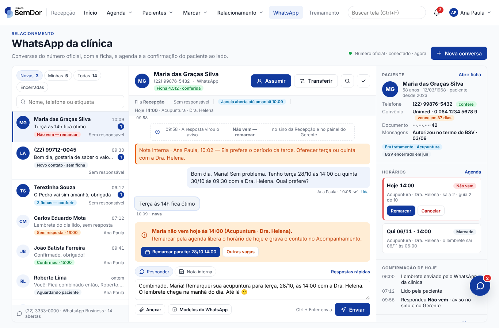
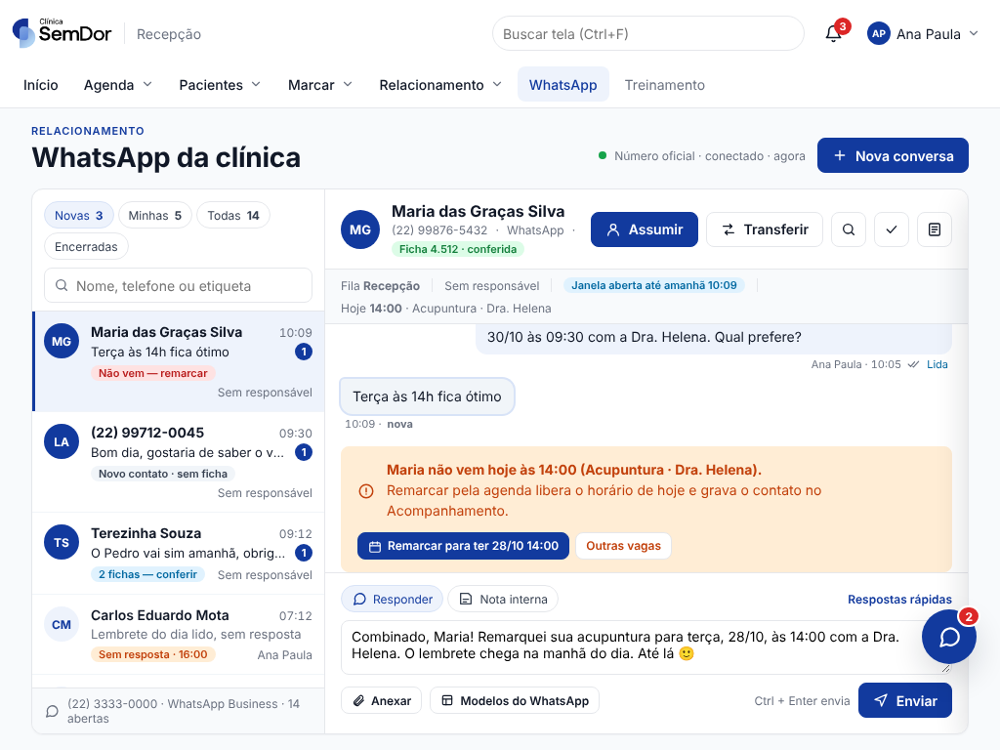
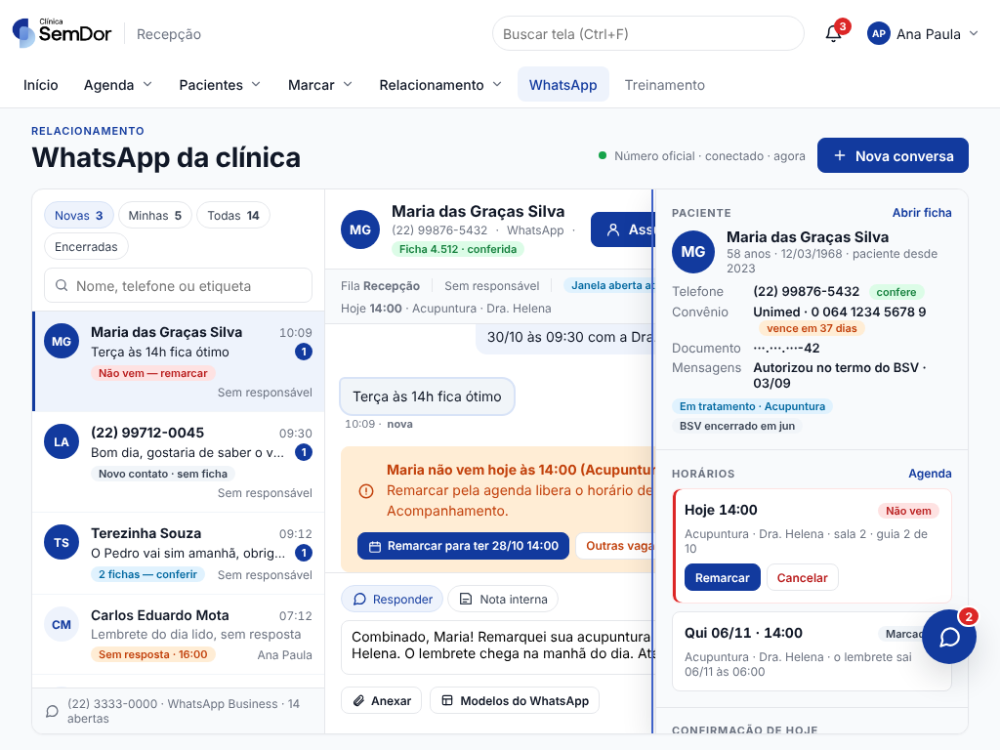
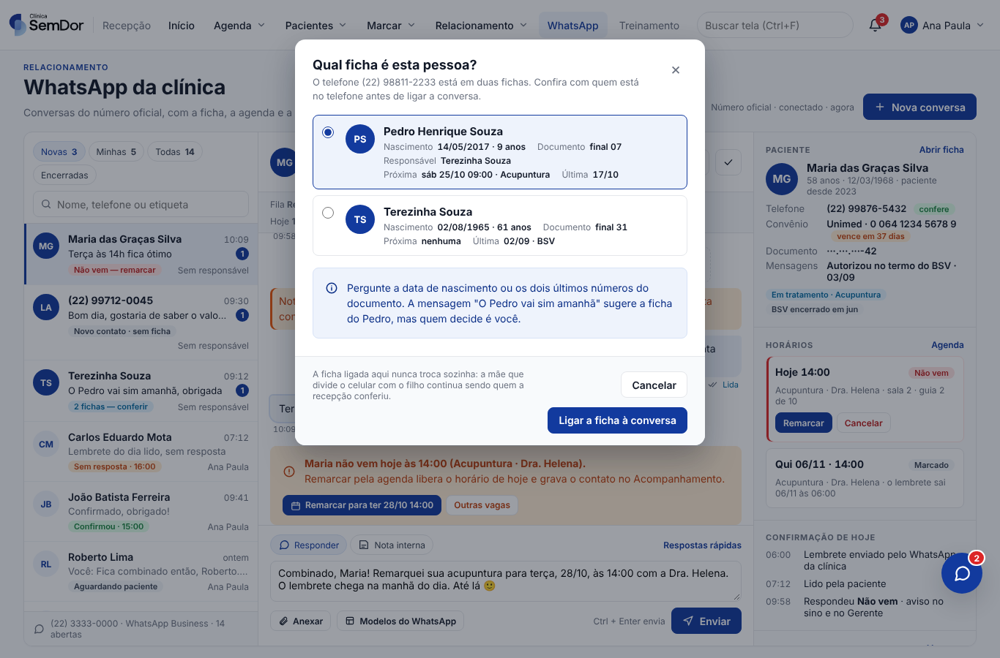

# O WhatsApp DENTRO da Recepção, e não o CRM dentro de uma moldura (proposta, out/2026)

> **Status: proposta com mockup, nada implementado.** A direção olhou a aba WhatsApp da fase 1
> (`docs/crm-na-recepcao.md`) e resumiu: *"o que foi feito foi clonar o CRM e colar dentro do
> sistema"*. Este documento responde à pergunta que veio junto, *"como você faria?"*, com a
> comparação dos caminhos nos três eixos (UX · DX · CX) e um mockup feito sobre o CSS REAL da
> casa. O mockup está em `docs/mockups/whatsapp-nativo/` (fotos abaixo).

## 1. O que existe hoje e por que incomoda

A aba **WhatsApp** da Recepção abre o CRM inteiro (`https://crm…/?modo=recepcao`) num `iframe`,
entrando sem senha por um bilhete de uso único. O CRM esconde Agenda, Meu dia, Relacionamento e o
sino, e o resto fica igual ao navegador. Foi a escolha mais barata e a mais segura para a
fase 1, e ela resolveu o Alt+Tab e a segunda senha.

O que ela NÃO resolve, medido no que a pessoa vê:

| Sintoma | Causa |
|---|---|
| Dentro da janela da Recepção aparece outro produto: outra fonte, outros botões, outro cinza, outro "ficha do contato" | São dois design systems na mesma tela. O CRM tem o `design.css` dele; a Recepção tem os tokens do `Tokens.xaml`. |
| A ficha que o CRM mostra ao lado da conversa é a cópia que ele monta pela ponte (`ClinicPatientCard`): nome, convênio, próximas sessões | A informação verdadeira está a um clique, no mesmo app, e a tela não a usa. A agenda, a confirmação do dia, o Acompanhamento e o 2º código já estão carregados pela Recepção. |
| "Remarcar", "Confirmar" e "Cancelar" na conversa passam pelo CRM, que chama a ponte, que chama o `AgendaService` | Três saltos para uma ação que o app ao lado faz em um. |
| Sessão do CRM vence em 2 h e aparece "Entrar de novo" | A moldura não sabe renovar; o app sabe emitir bilhete à vontade. |
| A barra de cima da aba explica "Agenda e Relacionamento continuam nas abas da Recepção" | Texto que existe para pedir desculpa pelo que a tela não integra. |
| O sino da Recepção diz "Atenção no WhatsApp" e leva à aba; dentro dela a pessoa procura a conversa | O aviso e a conversa estão em sistemas diferentes. |

A regra 1 da direção para telas de quem atende (*uma porta por pergunta*) está formalmente
atendida (uma aba), mas a porta abre para outra casa.

## 2. Os caminhos comparados

| | 🧑‍💻 UX (quem usa) | 🛠️ DX (quem mantém) | 🤝 CX (a clínica) |
|---|---|---|---|
| **A · Moldura do CRM (hoje)** | Dois produtos numa janela; ficha duplicada; ações da agenda em três saltos; "Entrar de novo" a cada 2 h; a aba não conversa com a agenda nem com a ficha. | Quase nenhum código no Clinica (bilhete + `iframe`). Mas cada tela nova da Recepção que quer "a conversa ao lado" tem de navegar até a aba e passar um pedido pela URL (`PedidoDeConversaNoCrm`), e o `modo=recepcao` precisa esconder no CRM o que a Recepção já tem, para sempre. | Barato, sem servidor novo. "Parece profissional?": não, parece colado, e foi exatamente isso que a direção viu. |
| **B · Tela nativa Blazor sobre a API do CRM** (recomendado) | Uma tela da casa: lista, conversa e, ao lado, a ficha, a agenda, a confirmação do dia e o Acompanhamento **lidos do próprio app**. Remarcar/cancelar são os botões da agenda da Recepção. O "pede ação" entra na conversa como aviso com os botões. Nunca pede senha. | Uma tela (`Telas/Recepcao/ConversasDoWhatsApp.razor`), um cliente HTTP do CRM (`IClienteDoCrm` na Application, `ClienteDoCrmHttp` na Infrastructure) e um modelo puro do que a tela afirma (`ConversasNaTela`, com teste). O CRM continua sendo o único que fala com a Meta e com o SMS: modelos, janela de 24 h, fila, jobs, PARAR, recall, @SemDor. Duas interfaces para os mesmos dados (esta e o CRM web/celular), o que exige um contrato de API estável e versionado. | Nenhum servidor novo. A recepção ganha a tela que o produto promete; o CRM web continua para o celular e para a gestão. O risco é a regressão do que o CRM web já faz (anexos, áudio, @SemDor), por isso a fase 1 entra atrás da configuração, ao lado da moldura. |
| **C · Reescrever a caixa de entrada no Clinica e aposentar o CRM** | Igual ao B para quem atende. | É a opção "clonar" de verdade: refaz no Clinica o que o CRM já tem (webhooks da Meta, mídia, modelos aprovados, SMS, recall, IA, qualidade, operação) e perde o celular. Duas verdades de WhatsApp durante meses. | Caro e demorado; interrompe uma operação que está em produção na VPS 2. Rejeitado. |
| **D · Só a conversa, como painel lateral nas telas que já existem** (Agenda do dia, Ficha, Confirmações) | A secretária nem muda de tela: a conversa abre ao lado do horário que ela está olhando. | Tecnicamente é o B com a conversa extraída como componente (`PainelDaConversa`), sem a lista. Não vive sozinho: alguém precisa ver "quem escreveu e ninguém respondeu", e isso é a lista. | Melhor dia de quem atende. É a **fase 2 do B**, não uma alternativa a ele. |

**Recomendação: B, em três fases, com D como a segunda.** A moldura (A) fica como está até a
fase 1 do B provar o mesmo trabalho na clínica; depois sai inteira (regra 2: função que sai, sai
inteira, com `modo=recepcao` e `CRM_EMBED_ORIGINS` do CRM junto).

## 3. O mockup

Feito sobre o CSS **real** do app, não sobre um desenho: `gerar.py` concatena `tokens/*.css`
(os mesmos do `Tokens.xaml`), `clinica.css`, `moldura.css`, `chat-equipe.css` e o
`conversas.css` proposto (só tokens), e produz o `index.html`. Os ícones seguem o traço do
`Componentes/Icone.razor`. O que está nas fotos é o que a tela Blazor desenharia com essas
classes.

```bash
python3 docs/mockups/whatsapp-nativo/gerar.py      # regenera index.html e artefato.html
# abra docs/mockups/whatsapp-nativo/index.html; #ficha abre o formulário da regra 5; #contexto abre a ficha em 1024
```

| 1366 × 900 | 1024 × 768 |
|---|---|
|  |  |
| Em 1024 a coluna do paciente vira painel por cima da conversa (botão "ficha" no cabeçalho):  | O formulário da regra 5, "Qual ficha é esta pessoa?":  |

O que cada parte da tela diz, e de onde vem:

- **Coluna 1, a lista** (do CRM: `GET /api/conversations`). Chips *Novas · Minhas · Todas ·
  Encerradas* com a contagem antes do clique (o `.chip` comum), busca, e em cada linha o selo
  do que a conversa PEDE: *Não vem — remarcar*, *Sem resposta · 16:00*, *2 fichas — conferir*,
  *Novo contato · sem ficha*, *Confirmou*. O selo vem da MESMA decisão do sino
  (`AvisosDeConfirmacao`), não de um segundo cálculo.
- **Coluna 2, a conversa** (do CRM: `GET /api/conversations/{id}`, `POST …/reply`, `…/notes`,
  `…/claim`, `…/transfer`, `…/close`, `…/read`, `GET /api/templates/{sender}`,
  `POST …/attachments`). Bolhas recebida/enviada com estado de entrega, nota interna, os
  eventos do sistema na linha do tempo ("06:00 · Lembrete do dia enviado…", "09:58 · virou o
  aviso Não vem"), a janela de 24 h da Meta no cabeçalho, e o **aviso que pede ação** com os
  botões da agenda da Recepção. Escrever: Responder / Nota interna, Modelos do WhatsApp,
  Anexar, Ctrl+Enter.
- **Coluna 3, o paciente** (do próprio Clinica, pelos serviços que a Recepção já usa):
  cabeçalho da ficha (`FichaDoBalcao.Cabecalho`), telefone confere, carteirinha e vencimento,
  autorização de mensagens do termo do BSV, tratamento em curso; os horários com Remarcar /
  Cancelar (`AgendaService`); a confirmação de hoje (`AvisosDeConfirmacaoService`); o
  Acompanhamento com o contato registrado sozinho (`ClinicContactNotice` continua valendo: quem
  grava o contato é o CRM via ponte, como hoje, e a tela só mostra).
- **"Qual ficha é esta pessoa?"** é a regra 5 (*o telefone não é identidade*): o app busca as
  fichas candidatas com a sua própria busca (`BuscaDePacienteNaTela`), a recepção confere
  nascimento/fim do documento/próxima consulta e só então o app liga a ficha na conversa
  (`POST /api/conversations/{id}/patient`). A ficha ligada nunca troca sozinha.

## 4. Como se constrói (a fase 1)

Peças novas, e onde cada regra mora:

| Peça | Camada | O que faz | Teste |
|---|---|---|---|
| `IClienteDoCrm` | Application/Abstracoes | Listar conversas, abrir uma, responder, nota, assumir, transferir, encerrar, marcar lida, modelos, anexar, ligar ficha. Erros viram `RecusaDoCrm` (texto para a tela), nunca exceção solta no evento. | fake em memória para as telas |
| `ClienteDoCrmHttp` | Infrastructure | `HttpClient` com `CookieContainer` por sessão; entra com um bilhete (`IEntradaNoCrmService`) e **renova sozinho** quando o CRM responde 401 (o app pode emitir bilhete à vontade; a pessoa nunca vê "Entrar de novo"). Lê o `csrf` de `GET /api/session` e o manda em toda escrita. | contra um servidor falso (`WireMock`-like já existe para a ponte em `PonteClinicTeamTests`) |
| `ConversasNaTela` | Application/Modelos | PURO: o selo de cada linha, o texto da janela de 24 h, o que "pede ação" e qual botão oferece, a ordem da lista, a classificação da entrega. | `ConversasNaTelaTests` |
| `ConversasDoWhatsApp.razor` + `conversas.css` | Ui.Blazor | A tela do mockup. Escopo por operação, contador de geração, terceiro estado (`FalhaDeLeitura`: "o CRM não respondeu", distinto de "nenhuma conversa"), `Exigir(EditarAgenda)` nos botões que escrevem, `Dialogos` para confirmar transferir/encerrar, `Modal` para a ficha. | `TelasBlazorAbremTests` (semente `SementeConversasDoWhatsApp`), fotos em 1024 e 1366 |
| `ChaveWhatsAppCrm` | Modulo.Recepcao | O MESMO item de menu. Qual tela abre decide-se por configuração do Gerente (`ParametrosService`), para a fase 1 rodar ao lado da moldura na clínica. | `ModuloRecepcaoTests` |

Decisões já tomadas aqui, para não reabrir:

- **Atualização**: leitura a cada 7 s enquanto a aba está visível (é o que o CRM web faz hoje;
  `setInterval` de 7 s em `app.js`), com contador de geração e sem "Carregando" na releitura. SSE
  fica para quando o CRM oferecer; não é pré-requisito.
- **O que fica no CRM, sem discussão**: Meta e webhooks, modelos aprovados, janela de 24 h,
  mídia, SMS, recall, PARAR, @SemDor, qualidade, operação, o CRM web no celular.
- **O que a tela lê do Clinica, nunca do CRM**: ficha, agenda, confirmação, Acompanhamento,
  consultas a renovar. O `ClinicPatientCard` da ponte continua existindo para o CRM web.
- **O contrato da API do CRM passa a ser contrato**: hoje `/api/*` é interno do front do CRM.
  Antes da fase 1, o CRM documenta e versiona (`/api/v1/…` ou cabeçalho) o que a tela usa, e
  o `ClinicContracts.cs` ganha os records da resposta, idênticos nos dois repositórios como
  sempre.
- **O item do menu continua "WhatsApp"**: é a palavra de quem atende. O título da tela diz "da
  clínica" porque o número é o oficial, não o do computador.

### As fases

1. **A tela nativa, ao lado da moldura** (configuração do Gerente escolhe). Lista, conversa,
   contexto, ficha, modelos, anexos. Sem gravação de áudio e sem @SemDor na primeira versão
   (os dois continuam no CRM web).
2. **A conversa como painel** nas telas que hoje "navegam até a aba" (Agenda do dia, Ficha do
   balcão, Confirmações, Acompanhamento): o `PedidoDeConversaNoCrm` vira abrir o painel, sem
   trocar de tela. É o caminho D.
3. **A moldura sai inteira**: `WhatsAppNoCrm.razor`, `whatsapp-crm.css`, o `modo=recepcao`
   e `CRM_EMBED_ORIGINS` no CRM, a frase "continuam nas abas da Recepção". A entrada por
   bilhete FICA (é o que o cliente HTTP usa).

## 5. UX · DX · CX da recomendação

- 🧑‍💻 **UX**: uma tela da casa, no idioma da casa. A pergunta da secretária com o paciente no
  telefone ("ela vem hoje? tem horário terça? a carteirinha vale?") se responde na mesma
  janela, e a ação que a resposta pede (remarcar) é um botão ao lado da mensagem. Nenhuma
  senha, nenhum "Entrar de novo", nenhum cinza diferente. Em 1024 × 768 (o notebook mais
  apertado da clínica) a conversa e a lista cabem e o paciente abre por cima.
- 🛠️ **DX**: cinco peças novas, cada regra num lugar só (o que a tela afirma em
  `ConversasNaTela`, o que pede ação em `AvisosDeConfirmacao`, a agenda no `AgendaService`),
  um cliente HTTP testável contra servidor falso, e o CRM intocado por dentro. O custo real é o
  contrato da API, que hoje não existe como contrato. Lição já escrita em
  `docs/agentes/convencoes.md`: classes de tela nova levam o prefixo da tela (`entrada`,
  `saida` e `dica` já eram do comum e o mockup colidiu com as três).
- 🤝 **CX**: nenhum servidor novo; o CRM em produção não para. A clínica recebe o que o produto
  prometeu ("a mesa de trabalho da secretária") em vez de duas mesas encostadas. O risco de
  regressão fica contido pela fase 1 ao lado da moldura: se algo faltar, a direção volta a
  moldura num campo de configuração, sem release.

## 6. O que NÃO foi feito, e por quê

- **Nenhuma linha de código do app**: a direção pediu o desenho e o caminho; o código vem
  depois do "sim", fase a fase, cada uma com o seu PR.
- **O contrato da API do CRM não foi congelado**: é trabalho do repositório `semdor-crm`, e
  é o primeiro PR da fase 1.
- **Gravação de áudio e @SemDor na tela nativa**: ficam no CRM web até a fase 1 estar na
  clínica; entrar com tudo de uma vez é o que faria a regressão que o CX acima evita.
- **Relacionamento do CRM no celular**: fora do escopo, continua como a direção decidiu.
