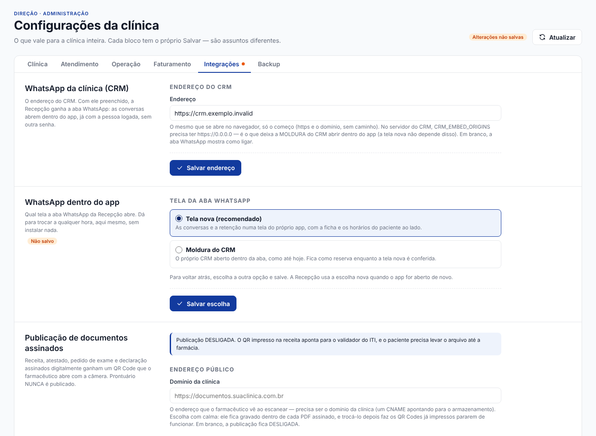

# WhatsApp nativo na Recepção: o roteiro da manhã

> **Para a direção, antes de a clínica abrir.** Isto põe no ar a tela nova do WhatsApp na
> Recepção. São cinco partes, nesta ordem: conferir, publicar o CRM, publicar os apps, ligar
> e conferir a tela. Cada passo diz o que fazer e o que conferir depois.
>
> Tempo total: cerca de 1 h 30, quase tudo esperando o GitHub compilar.
>
> Se algo der errado no meio, pare ali. **Nada muda para as secretárias até a parte 4**
> (ligar a tela nova). Até lá, a aba WhatsApp continua abrindo a moldura do CRM de hoje.

Os detalhes de cada peça estão em `docs/whatsapp-nativo-implementacao.md`. O CRM em produção
está descrito em `semdor-crm/docs/producao-out2026.md` (VPS 2) e em
`docs/crm-em-producao-out2026.md` (VPS 1 e os apps).

---

## 0. Antes de começar (5 min)

| Conferir | Como | Se falhar |
|---|---|---|
| A aba WhatsApp de hoje funciona | Abra a Recepção e clique em **WhatsApp**. O CRM tem de abrir **sem pedir senha**. | A tela nova entra pelo mesmo bilhete. Sem isso ela também não entra. Pare e veja a ponte (VPS 1). |
| O GitHub Actions está liberado | github.com → Settings → Billing. Em 21/10 ele estava bloqueado por pagamento. | Sem Actions, os apps não são publicados. O CRM pode ser montado no PC (parte 1). |
| Os PRs estão prontos | Os dois PRs da parte 1 e da parte 2 existem e o CI deles está verde. | Não publique com CI vermelho. |

**O que vai junto com o CRM.** O pacote leva tudo o que está na `main` do CRM, não só o
PR 0. Veja o que está no ar hoje, na VPS 2:

```text
ssh -o BatchMode=yes clinica-admin@191.252.92.246 "sudo cat /opt/semdor-crm/installation/state.json"
```

O campo `current` começa com os 12 primeiros caracteres do commit no ar. No PC, dentro do
repositório `semdor-crm`:

```text
git fetch origin
git log --oneline <os 12 caracteres>..origin/main
```

A lista mostra o que ainda não está no ar. A documentação registra `79f823e` (21/10) como a
última versão publicada. Se as fases 1 a 3 (PRs #36, #37 e #38) e o @SemDor (#32, #33 e #35)
aparecerem na lista, eles também vão junto.

Nada liga sozinho: cada função nova depende da sua variável no `production.env`. Mesmo
assim, saiba o que vai junto.

---

## 1. Publicar o CRM na VPS 2 (30 a 40 min)

O PR 0 está na branch `claude/whatsapp-system-integration-ankslw` do `semdor-crm`. Ele traz:

- as rotas que a tela nova usa: a lista com o tick e a releitura com `?desde=`;
- o teste que trava o contrato;
- **uma mudança de comportamento**: quando um membro da equipe não tem perfil gravado no CRM,
  o administrador dele passa a ser quem é administrador no Clinica, e não o primeiro da lista.

### 1.1 Juntar na `main`

O pacote se monta **a partir da `main`** (é a regra de `producao-out2026.md` §5).

```text
gh pr create -R lucaszaous-creator/semdor-crm --base main --head claude/whatsapp-system-integration-ankslw --title "API para os apps: lista com tick, ?desde= e teste de contrato (PR 0 do WhatsApp nativo)" --body "Ver docs/api-para-os-apps.md"
```

Espere o CI **"Testes do CRM"** ficar verde no PR e junte:

```text
gh pr merge <número> -R lucaszaous-creator/semdor-crm --merge
```

✅ **Conferir:** a `main` do CRM tem o merge (`git log -1 origin/main` depois de `git fetch`).

### 1.2 Montar o pacote no PC (PowerShell, na pasta do `semdor-crm`)

```powershell
git checkout main; git pull
$commit = git rev-parse HEAD
$pasta = "$env:TEMP\crm-$($commit.Substring(0,12))"
dotnet publish src/Clinica.Crm/Clinica.Crm.csproj -c Release -p:UseAppHost=false -p:IsTransformWebConfigDisabled=true -p:DebugType=None -p:DebugSymbols=false -o "$pasta\pub"
python tools/crm-release.py pack --published "$pasta\pub" --destination "$pasta\pacote" --commit $commit
```

O `pack` imprime três valores. **Anote o `releaseId` e o `manifestSha256`**.

Há um atalho, se o Actions estiver liberado: o CI da `main` já monta o mesmo pacote. Ele fica
no artefato `semdor-crm-<commit>` (`gh run download`), e o resumo está em
`crm-pacote-resumo.json`.

### 1.3 Copiar e instalar na VPS 2

```powershell
scp -r "$pasta\pacote" clinica-admin@191.252.92.246:/tmp/crm-pacote
```

Depois, na VPS 2 (`ssh clinica-admin@191.252.92.246`). Use **só esta chave e este usuário**:
o fail2ban bane o IP de quem erra.

```text
sudo chmod -R a+rX /tmp/crm-pacote
python3 /opt/semdor-crm/crm-release.py verify --package /tmp/crm-pacote --manifest-sha256 <manifestSha256>
sudo systemctl stop semdor-crm
sudo -u semdor-crm python3 /opt/semdor-crm/crm-release.py stage --package /tmp/crm-pacote --installation /opt/semdor-crm/installation --manifest-sha256 <manifestSha256>
sudo -u semdor-crm python3 /opt/semdor-crm/crm-release.py select --installation /opt/semdor-crm/installation --configuration /etc/semdor-crm/production.env --release-id <releaseId> --backup-destination /var/backups/semdor-crm/selecao-$(date +%Y%m%d)-<7 primeiros do commit>
sudo systemctl start semdor-crm
```

A ordem importa:

- o serviço **parado** antes do `stage`, porque com ele rodando a resposta é "Instalação em uso";
- o `select` faz e confere o backup dos dados antes de trocar a versão.

Cada comando responde uma linha em JSON. Se aparecer `"error"`, pare e não ligue o serviço com
outra versão.

✅ **Conferir:**

1. `curl -s https://crm.clinicasemdormacae.com.br/health/ready` responde **JSON** com
   `"status":"ready"`. Não é o texto `ready`: um roteiro que compare o texto puro dá a versão
   por quebrada sem motivo (aconteceu em 21/10).
2. Teste **pela URL pública**. Direto na porta 8080, sem o Caddy, a resposta é 400.
3. O CRM no navegador abre, entra e mostra as conversas.
4. Na Recepção, a aba WhatsApp (a moldura de hoje) continua abrindo sem senha.
5. Em **Equipe**, confira quem aparece como administrador. É a mudança de comportamento
   do PR 0.
6. Apague o pacote copiado: `rm -rf /tmp/crm-pacote`.

**Voltar atrás no CRM:** com o serviço parado, troque `select … --release-id <releaseId>` por
`rollback` com os mesmos `--installation`, `--configuration` e um `--backup-destination` novo.
Depois ligue o serviço. O `rollback` volta para a versão anterior e não mexe nos dados.

---

## 2. Publicar os apps: Recepção e Gerente (40 min)

**O CRM primeiro, depois os apps.** O app novo com o CRM antigo não quebra, porque a tela
nova continua desligada até a parte 4. Mas não haveria o que conferir.

### 2.1 Juntar o PR do Clinica

O PR leva a branch `claude/whatsapp-system-integration-ankslw` (rodadas 1 e 2 juntas) para a
`main`. O CI (`build-exe`) compila os cinco apps e roda a suíte inteira, em cerca de 25 min.
Com tudo verde:

```text
gh pr merge <número> -R lucaszaous-creator/Clinica --merge
```

**Não há migration nesta entrega.** Para conferir, este comando não deve listar nada:

```text
git diff --stat origin/main~1 origin/main -- src/Clinica.Infrastructure/Migrations
```

### 2.2 Quem precisa de versão nova

| App | Precisa? | Por quê |
|---|---|---|
| **Recepção** | sim | Carrega a aba WhatsApp |
| **Gerente** | sim | Carrega todos os módulos, inclusive a aba, e é onde fica a escolha da tela |
| Financeiro e Consultório | não | Carregam a Recepção só como contexto, sem o item WhatsApp no menu |
| Faturamento | **não** | Não tem a aba. Não republique sem necessidade: ele está em produção |

### 2.3 As tags, uma por vez

A próxima versão é a última tag **daquele** app + 1. Em 24/10 as últimas eram
`recepcao-v1.2.73` e `gerente-v1.2.86`. Confira de novo antes de criar:

```text
git checkout main; git pull; git fetch --tags
git tag -l "recepcao-v*" --sort=-v:refname | head -1
git tag -l "gerente-v*" --sort=-v:refname | head -1
```

Envie **uma tag por `git push`**. Com mais de três tags no mesmo push, o GitHub não dispara
nada (aconteceu em out/2026).

```text
git tag recepcao-v1.2.74
git push origin recepcao-v1.2.74
git tag gerente-v1.2.87
git push origin gerente-v1.2.87
```

O atalho sem tag é Actions → "Release" → Run workflow, uma execução por app:

```text
gh workflow run "Release (instalador + auto-update)" -R lucaszaous-creator/Clinica --ref main -f app=recepcao -f version=1.2.74
```

✅ **Conferir:**

1. Em Actions, as duas execuções de "Release" ficam verdes. O job `sincronizar-canais` pode
   aparecer **cancelado** quando duas rodam juntas. Isso é normal: basta o último ter passado.
2. Em Releases, `recepcao-v1.2.74` e `gerente-v1.2.87` têm os arquivos.
3. Abra o Gerente na sua máquina. Ele se atualiza sozinho e reabre.

---

## 3. O que mudou na tela de Configurações

Gerente → Configurações → **Integrações** ganhou um bloco novo, logo abaixo do Endereço do
CRM: **"WhatsApp dentro do app"**.



- **Tela nova (recomendado)**: as conversas e a retenção numa tela do próprio app, com a ficha
  e os horários do paciente ao lado.
- **Moldura do CRM**: o CRM aberto dentro da aba, como até hoje. É o padrão e fica como
  reserva.
- A escolha só aparece habilitada **com o endereço do CRM salvo**. Sem ele, o bloco diz
  "Salve o endereço do CRM primeiro" (foto `configuracoes-whatsapp-sem-endereco-1024.png`).
- Pede o mesmo acesso do endereço do CRM: **gerenciar usuários**.

⚠️ **A escolha vale para a clínica inteira, não só para uma máquina.** Ela fica gravada no
banco. Cada Recepção passa a usar a tela escolhida **quando o app dela for aberto de novo**.
Por isso, ligue e confira **antes** de as secretárias chegarem. Assim, se algo faltar, dá tempo
de voltar.

---

## 4. Ligar e conferir (20 min)

1. No Gerente: Configurações → Integrações → WhatsApp dentro do app → **Tela nova** →
   **Salvar escolha**.
2. Numa máquina da Recepção: feche o app e abra de novo (ele também se atualiza). Entre com o
   **usuário de uma secretária** que tenha acesso à agenda.
3. Clique em **WhatsApp**.

Para os testes de envio, use **o seu celular e um paciente de teste**. Nunca um paciente de
verdade: tudo o que sai, sai pelo número oficial da clínica.

| ✅ | O que conferir |
|---|---|
| ☐ | **Entra sem senha.** A lista aparece sem nenhuma tela de login do CRM. |
| ☐ | **A lista aparece** com as conversas, os filtros Novas, Minhas, Todas e Encerradas, e as contagens. |
| ☐ | **Envia.** Mande uma mensagem do seu celular para o número da clínica e responda pela tela. Com a janela de 24 h fechada, só aparece "Escolher modelo". |
| ☐ | **O tick muda** de enviada para entregue e depois para lida, sem recarregar (a tela relê a cada poucos segundos). |
| ☐ | **Remarcar** um horário do paciente de teste pela coluna da direita. A agenda do balcão mostra a mudança. Depois, desfaça. |
| ☐ | **Retenção.** O seletor Conversas / Retenção mostra os grupos. Quem não autorizou mensagens só tem "Já liguei". **Não envie convite a paciente real** neste teste. |
| ☐ | **O sino leva à conversa.** Um aviso de confirmação no sino abre a conversa certa. |
| ☐ | **Trocar usuário.** "Trocar usuário" reabre o app. Entre com outra pessoa, responda à conversa de teste e confira que a mensagem sai **com o nome dela**, não com o da anterior. |

Se a tela mostrar "O CRM não respondeu" ou "não aceitou o acesso", veja o log do app
(`Diagnostico`) antes de mexer em qualquer coisa.

### Voltar atrás, sem release

Gerente → Configurações → Integrações → **Moldura do CRM** → **Salvar escolha**. Depois feche e
abra a Recepção. A aba volta a ser a moldura de hoje. Não precisa instalar nada.

A volta não alcança um defeito **fora da aba**, por exemplo o app que não abre. Aí a correção é
um release novo. Não existe volta automática de versão dos apps.

---

## 5. O que depende da direção

Nada disso trava o que está acima. São decisões para a próxima rodada.

1. **Degraus 30, 20 e 15 dias na retenção.** Hoje o Gerente tem **um número só** ("Recall:
   dias sem vir", padrão 60), e a lista sai num grupo só. Quer os três degraus como
   configuração nova do Gerente, ou um limite basta?
2. **Os nomes reais dos modelos aprovados na Meta.** A tela preenche as variáveis pelo nome do
   modelo (`lembrete_sessao`, `retorno_tratamento`, `recall_semdor`…). Em produção os nomes
   são outros: por exemplo, `semdor_lembrete_sessao` e `semdor_iniciar_atendimento`. Com um
   nome desconhecido, a tela mostra "Variável 1, 2…" em branco para a secretária preencher.
   Ninguém inventa valor, mas a secretária digita. Mande a lista de Configurações → Modelos do
   CRM para ligar os nomes.
3. **"Como se sentiu depois da 1ª sessão de BSV"** precisa de uma fila nova no Acompanhamento?
   Hoje "Novos no BSV" são os que **ainda não** fizeram a 1ª sessão.

### O que fica para as fases 2 e 3

- **Fase 2 (depois de a tela nova estar em uso):** a conversa vira um **painel ao lado** da
  Agenda do dia, da Ficha, de Confirmações e do Acompanhamento, sem trocar de tela. Então se
  decide o destino da tela Acompanhamento.
- **Fase 3:** a moldura **sai inteira**, junto com a escolha deste bloco. Saem a tela
  `WhatsAppNoCrm`, o CSS e a semente dela, e, no CRM, o `modo=recepcao`, o `modo-recepcao.js`,
  o `CRM_EMBED_ORIGINS` e o teste dele. A entrada por bilhete **fica**: é por ela que a tela
  nova entra.

---

## 6. 🧑‍💻 UX · 🛠️ DX · 🤝 CX

- 🧑‍💻 **UX**
  - **Direção:** a escolha fica num bloco só, ao lado do endereço do CRM. Uma frase explica
    cada opção. Quando a escolha está bloqueada, o bloco diz por quê. A volta é um clique.
  - **Secretária:** nada muda até a direção ligar. Depois, ela abre a conversa no próprio app,
    sem senha e sem trocar de sistema.
  - **Saída do app:** "Sair" e "Trocar usuário" encerram a sessão da pessoa no CRM na hora.
    Sem isso, ela continuava valendo no servidor até vencer (2 h).
  - Fotografado em 1024 e 1366, com e sem endereço do CRM
    (`docs/mockups/whatsapp-nativo/tela-real/`).
- 🛠️ **DX**
  - **As frases e a regra da escolha** moram em `ConfiguracoesDaClinicaNaTela`
    (`PorQueSemEscolhaDoWhatsApp`, `FraseWhatsAppSalvo`), com teste.
  - **A chave** é `ParametrosService.ChaveWhatsAppNativo`. O teste fixa o padrão desligado,
    a gravação, a releitura e que só o valor `true` liga.
  - **A saída do CRM** tem um ponto só: o fechamento da `JanelaDoApp`. "Trocar usuário" reabre
    o processo, então passa por ali também. A peça é `Infrastructure/Crm/SaidaDoCrm`, testada
    em `ClienteDoCrmHttpTests`: o logout já chegou ao CRM quando ela volta, e o CRM fora do ar
    não lança.
  - **A espera tem teto de 2 s.** Sem ela, o aviso morria com o processo e a chamada não fazia
    o que promete.
- 🤝 **CX**
  - **Custo:** nenhum servidor novo e nenhuma migration. São dois apps republicados, mais o
    CRM.
  - **Risco:** controlado pela escolha. Ela nasce desligada, liga quando a direção quer e volta
    sem release. O CRM tem o próprio `rollback`.
  - **Confiança:** a direção liga antes de a clínica abrir e confere com o próprio celular.
    Paciente nenhum recebe teste.

## 7. O que NÃO foi feito, e por quê

- **Ligar por máquina.** O plano original dizia "liga numa máquina, depois nas outras". A
  configuração da clínica mora no banco e vale para todas. Uma escolha por máquina seria uma
  segunda configuração para manter. Ligar antes de a clínica abrir e conferir resolve o mesmo
  risco com zero peça nova.
- **A troca na hora, sem reabrir o app.** A aba fica montada o dia inteiro. Trocar a tela por
  baixo de quem está escrevendo apagaria o rascunho. A troca vale na próxima abertura.
- **O logout do Faturamento.** Ele não tem a aba WhatsApp nem sessão no CRM.
- **Publicar, criar tag ou disparar workflow.** O roteiro é para a direção executar. Nenhum
  comando acima foi rodado.
- **Os PRs 3 e 4 (a tela e a retenção)** são de outra frente desta rodada. Este roteiro assume
  que entraram na mesma branch antes do PR do Clinica.
